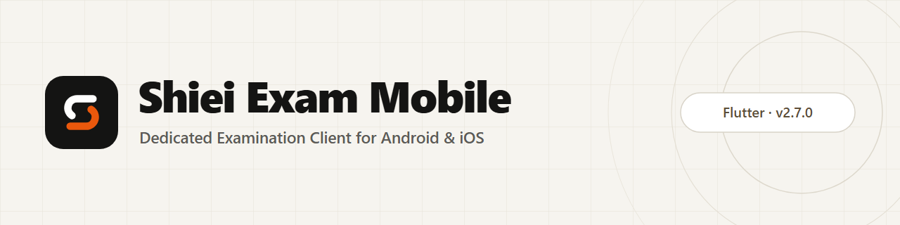

<p align="center">
  
</p>

<p align="center">
  <a href="https://flutter.dev"></a>
  <a href="https://dart.dev"></a>
  
  <a href="https://github.com/bimbap/shiei-exam-mobile-app/releases"></a>
</p>

> *Project SHIEI — Menjaga Integritas, Mengawal Kejujuran Ujian.*

---

## 📌 Overview

**Shiei Exam Mobile** is the dedicated student examination and on-the-go teacher proctoring application for **Project SHIEI**. Built with Flutter for Android and iOS, it provides a distraction-free testing environment for students while giving proctors immediate mobile oversight and real-time session management.

---

## 🛡️ Core Capabilities & Architecture

- **Dedicated Kiosk Examination Shell**: Full-screen containment and session locking designed to prevent unintended disruptions and maintain a focused testing environment.
- **Hardware & Environment Verification**: Comprehensive pre-flight system diagnostics to verify device readiness before exam authorization.
- **Real-Time Proctor Coordination**: Instant mobile supervision tools for teachers, including QR-based verification, live schedule adjustments, and student progress monitoring.
- **Offline Session Resilience**: Intelligent local answer caching ensuring exam continuity even in intermittent or disrupted school connectivity conditions.
- **Universal Cross-Platform Experience**: Responsive layouts tailored for smartphones, compact foldables, and educational tablet workstations.

---

## 🛠️ System Requirements

- **Flutter SDK**: `^3.24.0`
- **Dart SDK**: `^3.5.0`
- **Target Platforms**: Android 7.0+ (API 24+) / iOS 14.0+

---

## 📦 Getting Started

### 1. Prerequisites
Ensure you have Flutter installed and configured:
```bash
flutter doctor
```

### 2. Install Dependencies
```bash
cd mobile-app
flutter pub get
```

### 3. Run on Connected Device
```bash
# List available devices
flutter devices

# Run in debug mode
flutter run -d <DEVICE_ID>
```

### 4. Build Release Bundle
```bash
# Build Android APK (Fat APK)
flutter build apk --release

# Build Split Per-ABI APKs (Smaller downloads)
flutter build apk --split-per-abi --release

# Build Android App Bundle (for Google Play / MDM)
flutter build appbundle --release
```

---

## 📐 Project Structure

```
lib/
├── core/                 # Auth tokens, API client, security services & network layer
├── features/
│   ├── exam_list/        # Student exam dashboard & readiness diagnostics
│   ├── exam_player/      # Secure exam runner with question timer & auto-save
│   ├── lockout/          # Violation alarm screen & emergency unblock handler
│   ├── onboarding/       # Permission gating guide (Notification & Install gates)
│   ├── settings/         # App diagnostics, sound testing & server configurations
│   ├── teacher_monitor/  # Mobile proctor command center (live tracking, QR, classes)
│   └── tour/             # Guided spotlight walkthrough for new teachers & students
└── shared/
    ├── theme/            # Shiei Design System (dark & light tokens)
    └── widgets/          # Responsive bottom sheets, selectors & custom UI controls
```

---

## 👨‍💻 Author

**Ibrahim Muliatama** ([@bimbap](https://github.com/bimbap))
